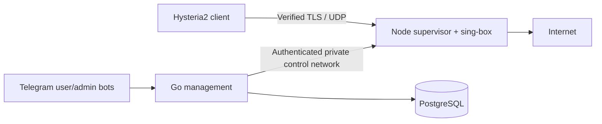
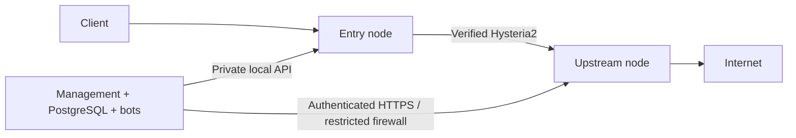

# Syranet

**Self-hosted VPN/Proxy Access Management** — Go, two Telegram bots, PostgreSQL and Hysteria2 with configurable entry/upstream nodes.

## What is Syranet?

Syranet provisions time-limited proxy access on your own servers. Users register and request access in Telegram; administrators approve, extend, suspend, revoke and rotate credentials. An authenticated node supervisor applies validated sing-box configurations and management retries pending changes.

The project grew from a personal infrastructure tool. It is not a commercial VPN provider, billing platform or built-in operating-system TUN client. A compatible Hysteria2 client decides which local traffic enters the proxy tunnel.

## Features

- Private-chat credential delivery and Telegram ID based administrator authorization.
- Independent 256-bit random Hysteria2 and SOCKS credentials; verified TLS and configurable SNI.
- Single-node direct egress, optional upstream chaining, multiple selectable entry endpoints and cycle detection.
- PostgreSQL migrations, transactional user changes/audits and persistent command deduplication.
- Serialized desired/applied reconciliation, validated atomic config replacement, process restart and attempted rollback.
- Node process/TLS health, sync hashes, subscription statistics and infrastructure alerts.
- Compose deployment without host systemd, D-Bus, host VPN config mounts or Docker socket access.
- Optional SOCKS5, disabled by default; no unreliable device counting or automatic connection-limit blocking.

## Supported architectures

One VPS is the primary deployment:



Optional two-node routing:



Each configured node runs the provided supervisor and its own sing-box process. Remote nodes are actually configured over their HTTPS API; SSH, arbitrary host commands and a pre-existing VPN are not required. More entry nodes can be registered; each user selects one entry. See [multi-node deployment](docs/MULTI_NODE.md).

## Requirements

- A Linux VPS with Docker Engine and Docker Compose v2.20+; the reference host is Ubuntu 24.04 LTS, amd64 or arm64.
- Python 3.9+, OpenSSL, Git and Certbot for the documented setup.
- A domain pointing directly to each public server, without an HTTP-only CDN proxy. The default certificate workflow uses a domain to get a publicly trusted certificate. IP endpoints are supported with a matching valid certificate/SNI configuration.
- Two Telegram BotFather tokens and your positive numeric Telegram user ID.
- Default public port: **443/UDP**. **80/TCP** must be reachable for Certbot standalone issuance and renewal. Remote management uses restricted **8443/TCP**. PostgreSQL and the local node API are not published.

The node executable is pinned to **sing-box 1.14.3**. PostgreSQL is pinned to **16.15**. Build/CI use Go **1.27.2**; the module requires Go 1.27.2+.

## Quick Start: one VPS

Install Docker Engine with its Compose plugin using the [official Ubuntu instructions](https://docs.docker.com/engine/install/ubuntu/). Use an account authorized to run Docker/Compose (or explicitly use sudo for those commands); the following setup expects that access. Then install the remaining host tools:

```sh
sudo apt-get update
sudo apt-get install -y git python3 openssl certbot
sudo systemctl enable --now certbot.timer

git clone https://github.com/fanat-sira/syranet.git
cd syranet
python3 scripts/setup.py
```

Setup prompts for the hostname, UDP port, both bot tokens (hidden input) and admin IDs. It generates private `.env` and `configs/local.yaml`, including random database/agent secrets. It refuses to overwrite existing files. The checked-in example hostname is never a working deployment configuration.

Create DNS A/AAAA records first. A published AAAA record must actually reach your VPS. For a fresh Ubuntu host using UFW, allow SSH **before** enabling it:

```sh
sudo ufw allow OpenSSH
sudo ufw allow 80/tcp
sudo ufw allow 443/udp
sudo ufw enable
```

If you chose another Hysteria2 port, use that UDP port instead of 443. Apply equivalent rules in the provider firewall. Docker-published ports also need provider/network restrictions; UFW alone must not be assumed to filter Docker forwarding.

Obtain and install the certificate, substituting your real hostname:

```sh
sudo certbot certonly --standalone -d vpn.example.com
sudo scripts/certificates.sh vpn.example.com
sudo certbot renew --dry-run
```

Configure the renewal hook described in [TLS setup](docs/TLS.md), then validate and start:

```sh
python3 scripts/setup.py --check
./deploy.sh
docker compose ps
docker compose logs --tail=100 manager node
```

`deploy.sh` builds images, runs the read-only application configuration check and waits for service health. It does not touch a host-installed VPN. An empty database creates no public user access; approve a Telegram request to provision a credential.

Open both bots in **private chats** and send `/start`. In the user bot, complete the questionnaire. In the admin bot, run `/pending`, then `/approve <user_id>`. Return to the user bot and send `/getkey`; import the URI into a Hysteria2-compatible client. A URI is delivered only when reconciliation confirms the current desired state. See [client and operational troubleshooting](docs/OPERATIONS.md).

## Telegram configuration

Create two different bots through Telegram's verified **@BotFather**, using `/newbot`. Keep both tokens secret. For your administrator ID, obtain the numeric ID from your own Telegram account/export or a trusted ID helper; never use a group ID or `@username`. Several IDs are comma-separated in `.env`.

No webhook or bot HTTP port is needed. Only one management instance should poll the same bots. All user and administrator commands are restricted to matching private chats. Key messages use Telegram's `protect_content` flag; this is not protection from screenshots or a compromised Telegram account. Administrators must start their private bot chat before it can send them notifications.

## TLS setup

Existing PEM certificates are supported. By default the node reads `/certs/fullchain.pem` and `/certs/privkey.pem` from a read-only mount; the source directory is `CERTS_DIR`. Certificates must match the configured SNI and be valid. Missing, expired or mismatched certificates block apply; verification is never silently disabled.

Certbot obtains and renews certificates outside sing-box. No deprecated embedded ACME configuration is used. The supervisor detects copied certificate changes during reconciliation and restarts its child. Remote HTTPS also loads the current API certificate for new TLS handshakes. See [issuance, permissions, automated renewal and private CAs](docs/TLS.md).

## Single-node deployment

`configs/single-node.yaml` describes one entry with `outbound: direct`. Setup writes a private copy and updates hostname, SNI and port. Standard routing changes require YAML, not handwritten sing-box JSON. Node state and PostgreSQL data live in named volumes; generated configs are private files.

The application owns only its containerized sing-box process. Any host-installed instance must use different ports or be migrated explicitly. Configuration changes **restart** the process and disconnect current sessions; clients can reconnect with credentials still in the desired state.

## Multi-node deployment

[docs/MULTI_NODE.md](docs/MULTI_NODE.md) gives commands for preparing the upstream VPS from this repository, issuing its certificate, generating independent secrets, restricting the HTTPS API and configuring `configs/multi-node.yaml`. It also explains how to add independent entry nodes and select them with `/servers` and `/select`.

Remote API TLS verification and bearer authentication are mandatory. Keep each agent URL unique. A missing/disabled upstream or routing cycle rejects configuration. There is no automatic geographic routing or mesh discovery.

## User and admin commands

User commands:

| Command | Purpose |
| --- | --- |
| `/start` | Register/resume the questionnaire; preserves existing access |
| `/servers` | List available entry endpoints |
| `/select <node_id>` | Select one enabled entry; reconcile old/new access |
| `/getkey` | Receive a verified-TLS Hysteria2 URI after successful sync |
| `/getsocks` | Optional unencrypted SOCKS link when explicitly public-enabled |
| `/status` | State and expiry date |
| `/extend` | Request an administrator-managed extension |

Admin commands use **internal user IDs**, not Telegram IDs:

| Command | Purpose |
| --- | --- |
| `/pending`, `/users [page]` | Requests and paginated users |
| `/search <id\|telegram_id\|@username>`, `/info <id>` | Find/review a user and bounded questionnaire answers; no passwords shown |
| `/approve <id>`, `/reject <id> <reason>` | Decide a completed request |
| `/extend <id> <days>` | Add 1–3650 days; expired users become active |
| `/suspend <id>`, `/activate <id>` | Suspend; resume only with unexpired subscription |
| `/revoke <id>` | Revoke credentials/access |
| `/rotate <id>` | Replace both protocol secrets; a revoked user becomes suspended |
| `/nodes`, `/stats`, `/help` | Sync/process health, subscription statistics and help |

A revoked user must be rotated before activation, and extended if expired. Repeated approval is a no-op for an already active user. Replayed Telegram administrative messages are transactionally deduplicated. A newly sent extension command is an intentional additional extension. Saved DB changes with unsuccessful apply are reported as **pending**, retried and visible in `/nodes`.

## Configuration reference

`.env` holds secrets/deployment parameters; YAML holds topology, TLS paths, listeners and policy. The Go binary reads its environment, **not `.env` automatically**. Compose supplies environment and mounts the YAML. Unknown YAML fields, malformed env values, invalid ports/IDs, insecure remote API URLs and invalid topology fail before management begins.

See [`.env.example`](.env.example), [configuration reference](docs/CONFIGURATION.md) and the [single](configs/single-node.yaml)/[multi](configs/multi-node.yaml) examples. Host paths and published ports must match their Compose mounts/mappings.

## Updating

Back up first, review release/migration notes and update your checkout explicitly:

```sh
scripts/backup.sh
# After inspecting the upstream changes:
git pull --ff-only
python3 scripts/setup.py --check
./deploy.sh
docker compose ps
```

Migrations run transactionally under a PostgreSQL advisory lock at management startup. Checksums prevent accidental edits of already applied migrations. Existing roles/passwords/databases do not change merely because `DB_*` changes. Do not use `docker compose down -v` for an update. Old binaries may be incompatible with a migrated schema; rollback can require restoration into a new database. [Compatibility notes](docs/IMPLEMENTATION.md) cover the legacy installation.

## Backup and restore

```sh
scripts/backup.sh
scripts/restore.sh backups/syranet-<timestamp>-<pid>.dump syranet_restore_check
```

Backup creates a mode-0600 PostgreSQL custom archive and a checksum, and verifies the archive index. Restore creates a **new** database and refuses an existing name; it never drops the configured database. Verify restored rows/migrations and plan an explicit cutover. Store `.env`, topology and TLS material in encrypted off-host backup as well. See [operations](docs/OPERATIONS.md).

## Troubleshooting

[docs/OPERATIONS.md](docs/OPERATIONS.md) covers invalid TLS, occupied ports, Telegram token errors, unavailable databases, rejected sing-box config, upstream failures, pending sync, client failures and expired subscriptions. Start with `docker compose ps`, manager/node logs and `/nodes`. A running container alone does not prove a client can connect or that upstream connectivity works.

## Security considerations

- Hysteria2 TLS verification stays enabled; client URI authentication matches the server's password exactly.
- SOCKS5 is disabled by default and is **not encrypted**. Private listeners are preferred; public listeners require explicit consent and a matching port publication/firewall rule.
- PostgreSQL, the local node API and generated configs are private. Remote TCP 8443 must be limited to the management host/VPN by provider/network firewall rules.
- Managers necessarily possess credentials and node tokens. Protect `.env`, volumes, database backups and administrator Telegram accounts.
- No connection/device count is inferred from unreliable Clash metadata. Monitoring reports actual process/TLS and sync state instead.

See [SECURITY.md](SECURITY.md), [security review](docs/SECURITY_REVIEW.md) and [third-party notices](docs/THIRD_PARTY.md).

## Development and testing

```sh
go test ./...
go vet ./...
go build -o bin/syranet ./cmd/vpn-service
python3 scripts/fetch-singbox.py
SINGBOX_TEST_BINARY=/tmp/syranet-tools/sing-box go test -race -count=1 ./...
python3 scripts/e2e.py
```

Without explicit test environment settings, real binary/PostgreSQL/Docker tests **skip**. The Docker harness creates fresh random secrets, one-day test certificates and its own randomly named project/volumes, then tests migrations, state transitions, TCP/UDP connectivity, verified TLS, direct/upstream egress, revocation/rotation, retry and persistence across restarts. It never loads deployment `.env` or touches production volumes.

GitHub Actions defines formatting, vet, tests/race, build, vulnerability/secret checks and Docker integration. [CONTRIBUTING.md](CONTRIBUTING.md) describes development; [VERIFICATION.md](docs/VERIFICATION.md) distinguishes executed checks from prepared or unverified scenarios.

## Current limitations

- Applying a configuration restarts sing-box and drops existing sessions; no zero-downtime reload is claimed.
- An unreachable node retains its last applied configuration until management recovers. A stopped manager cannot enforce newly expired subscriptions. Alert on unhealthy/stale reconciliation.
- No mesh orchestration, device limits, payments, built-in TUN client or web dashboard.
- One management instance is recommended: DB locks serialize config work, but Telegram long polling and in-memory questionnaire/reminder sessions are not an HA interface.
- Anonymous public access is never intentionally created. Private SOCKS is reachable only through the container/private network you explicitly arrange, not automatically on the host loopback.
- Docker E2E has passed on GitHub Actions. Real VPS deployment, public ACME issuance and live Telegram delivery remain unverified; see VERIFICATION.md for separate CI and production evidence.

## Project status

Engineering/deployment validation release, **not claimed production-ready**. Read the verification record before public use. No fabricated user counts, throughput or uptime guarantees are included. [Architecture and portfolio description](docs/PORTFOLIO.md) contains suggested repository metadata, not remotely applied changes.

## License

Original Syranet source: [MIT](LICENSE). The separate sing-box executable has its own [GPL-3.0-or-later license](licenses/SINGBOX-LICENSE); see [third-party notices](docs/THIRD_PARTY.md).
